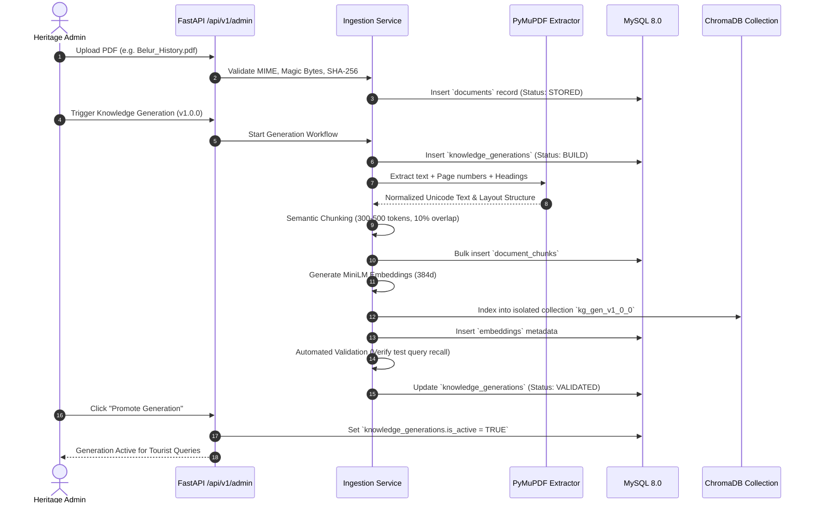
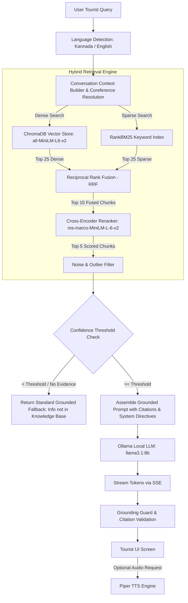

# System Architecture Specification

## Project Title
**AI-Powered Smart Tourist Guide Platform for Karnataka**

---

## 1. High-Level Architecture Overview

The platform implements a **Clean Architecture** with strict modular separation across Presentation, Application, Domain, and Infrastructure layers. The system operates as a hybrid local/cloud-native software platform with 100% offline self-hosted capability in standalone mode and containerized scalability in cloud mode.

```
┌─────────────────────────────────────────────────────────────────────────────┐
│                            PRESENTATION LAYER                               │
│  ┌─────────────────────────────────────┐   ┌─────────────────────────────┐  │
│  │   Tourist Experience (React 19)     │   │   Admin Portal (React 19)   │  │
│  │  - Bilingual Chat (Kannada/English) │   │  - Document Ingestion (PDF) │  │
│  │  - Voice Assistant (STT/TTS)        │   │  - Knowledge Generations    │  │
│  │  - Interactive Heritage Maps        │   │  - Retrieval Diagnostics    │  │
│  │  - Verifiable Citation Panel        │   │  - System Health & Models   │  │
│  └──────────────────┬──────────────────┘   └──────────────┬──────────────┘  │
└─────────────────────┼─────────────────────────────────────┼─────────────────┘
                      │ HTTP / REST / SSE Stream            │ JWT Auth / REST
┌─────────────────────▼─────────────────────────────────────▼─────────────────┐
│                      FASTAPI API GATEWAY (/api/v1)                          │
│   Rate Limiter • Security Headers • Request ID • Exception Handlers         │
├─────────────────────────────────────────────────────────────────────────────┤
│                             APPLICATION LAYER                               │
│  ┌───────────────────────────────────────────────────────────────────────┐  │
│  │ Use Cases & Orchestrators:                                            │  │
│  │ • ConversationEngine (Context, Coreference, Multi-turn)               │  │
│  │ • RAGOrchestrator (Hybrid Retrieval, RRF Fusion, Cross-Encoder)       │  │
│  │ • DocumentIngestionService (Extract, Clean, Chunk, Embed)             │  │
│  │ • GenerationManager (Build, Index, Validate, Promote, Rollback)       │  │
│  │ • SpeechOrchestrator (Whisper STT, Piper TTS)                         │  │
│  │ • TranslationService (Argos Offline English <-> Kannada)              │  │
│  │ • AdminAuthService (Argon2id, JWT Rotation, RBAC)                     │  │
│  │ • SystemHealthService (Telemetry, Subsystem Probes)                   │  │
│  └───────────────────────────────────┬───────────────────────────────────┘  │
├──────────────────────────────────────┼──────────────────────────────────────┤
│                               DOMAIN LAYER                                  │
│  ┌───────────────────────────────────┴───────────────────────────────────┐  │
│  │ Core Entities & Domain Rules:                                         │  │
│  │ • Document, DocumentChunk, KnowledgeGeneration, Citation, Message     │  │
│  │ • Strict Grounding Guard & Hallucination Defense                      │  │
│  │ • Domain Ports (ILLMProvider, IVectorStore, ISpeechToText, etc.)      │  │
│  └───────────────────────────────────┬───────────────────────────────────┘  │
├──────────────────────────────────────┼──────────────────────────────────────┤
│                         INFRASTRUCTURE LAYER                                │
│  ┌───────────────┐ ┌───────────────┐ ┌───────────────┐ ┌─────────────────┐  │
│  │   MySQL 8.0   │ │   ChromaDB    │ │  Ollama LLM   │ │ faster-whisper  │  │
│  │ (SQLAlchemy2/ │ │ (Persistent   │ │ (llama3.1:8b/ │ │ (Kannada /      │  │
│  │  Alembic)     │ │  MiniLM-L6)   │ │  mistral:7b)  │ │  English STT)   │  │
│  └───────────────┘ └───────────────┘ └───────────────┘ └─────────────────┘  │
│  ┌───────────────┐ ┌───────────────┐ ┌───────────────┐ ┌─────────────────┐  │
│  │   Piper TTS   │ │ NLLB-200 600M │ │     BM25      │ │  Cross-Encoder  │  │
│  │ (Speech Audio)│ │(Offline Model)│ │ (RankBM25)    │ │ (ms-marco Rerank│  │
│  └───────────────┘ └───────────────┘ └───────────────┘ └─────────────────┘  │
└─────────────────────────────────────────────────────────────────────────────┘
```

---

## 2. Clean Architecture Layer Boundaries (Lean Specification)

To prevent over-engineering while enforcing strict dependency inversion, domain ports are defined **only** for interchangeable external subsystems:

1. **Domain Layer**:
   - Holds pure business entities, value objects, and domain invariants.
   - Grounding rules: If evidence confidence is below threshold, output domain-mandated fallback message.
   - Declares abstract ports:
     - `ILLMProvider` (Generate stream, generate text)
     - `IVectorStore` (Add vectors, query top-k, delete collection)
     - `ISpeechToTextProvider` (Transcribe audio buffer)
     - `ITextToSpeech` (Synthesize text to audio stream)
     - `ITranslationProvider` (Translate text between supported pairs `en <-> kn`)
     - `IStorageService` (Store and retrieve raw PDF files)

2. **Application Layer**:
   - Contains application use cases and pipeline coordinators.
   - Coordinates multi-turn context assembly, RAG retrieval fusion, immutable generation state transitions, and audit logging.
   - Zero direct imports of concrete database drivers or external API SDKs.

3. **Infrastructure Layer**:
   - Concrete implementations of domain ports.
   - `SQLAlchemyMySQLRepository` for relational transactional storage.
   - `ChromaDBVectorStore` for vector search with `sentence-transformers/all-MiniLM-L6-v2`.
   - `OllamaLLMProvider` interfacing with the local Ollama daemon via HTTP.
   - `FasterWhisperProvider` running local quantized speech models.
   - `NLLBTranslationProvider` running local `facebook/nllb-200-distilled-600M` offline model (Argos excluded due to lack of official Kannada packages; IndicTrans2 blocked by Windows MSVC toolkit requirement).
   - `PiperTTS` generating lightweight wav/ogg speech audio.

4. **Presentation Layer**:
   - FastAPI REST endpoints & Server-Sent Events (SSE) routers under `/api/v1`.
   - React 19 Single Page Application with TanStack Query and Tailwind CSS.

---

## 3. Detailed Data Pipelines & Flow Architecture

### 3.1 PDF Ingestion & Immutable Generation Lifecycle
Knowledge updates **never** overwrite existing vector indexes in place. Each build creates an isolated, immutable generation.



#### Generation State Transitions:
$$\text{BUILD} \longrightarrow \text{PARSE} \longrightarrow \text{CHUNK} \longrightarrow \text{EMBED} \longrightarrow \text{INDEX} \longrightarrow \text{VALIDATE} \longrightarrow \text{PROMOTE} \longrightarrow \text{ACTIVE}$$
$$\text{ACTIVE} \longrightarrow \text{ROLLBACK} \text{ (Instant pointer swap without re-indexing)}$$

---

### 3.2 RAG Retrieval & Conversational Generation Flow



---

## 4. Relational Database Design (MySQL 8.0)

All application metadata, administrative controls, conversation audits, and generation lifecycles reside in MySQL 8.0.

### 4.1 Table Catalog

```text
1.  admins                   - Administrator credentials, roles, and status
2.  documents                - Uploaded source PDF files and extraction metadata
3.  knowledge_generations    - Immutable versioned knowledge generations
4.  generation_status        - Real-time pipeline execution stages and telemetry
5.  document_chunks          - Parsed text chunks with structural breadcrumbs
6.  embeddings               - Vector indexing metadata mapping to ChromaDB
7.  chat_sessions            - Anonymous tourist chat sessions
8.  chat_messages            - Tourist & assistant conversation turns with citations
9.  audit_logs               - Administrative action audit trails
10. system_logs              - Structured operational and error logs
11. deployment_history       - Deployment profile releases and rollouts
12. health_metrics           - Periodic hardware and subsystem health telemetry
13. model_registry           - LLM and embedding model configurations
14. voice_registry           - TTS and STT voice profile configurations
15. translation_registry     - Argos translation model package registry
16. system_settings          - Dynamic runtime platform configurations
```

### 4.2 Detailed Table Schemas

```sql
-- 1. Admins Table
CREATE TABLE admins (
    id VARCHAR(36) PRIMARY KEY,
    username VARCHAR(50) NOT NULL UNIQUE,
    email VARCHAR(100) NOT NULL UNIQUE,
    hashed_password VARCHAR(255) NOT NULL,
    role ENUM('SUPER_ADMIN', 'SITE_CURATOR', 'OPERATOR', 'VIEWER') NOT NULL DEFAULT 'VIEWER',
    is_active BOOLEAN NOT NULL DEFAULT TRUE,
    last_login_at TIMESTAMP NULL,
    created_at TIMESTAMP NOT NULL DEFAULT CURRENT_TIMESTAMP,
    updated_at TIMESTAMP NOT NULL DEFAULT CURRENT_TIMESTAMP ON UPDATE CURRENT_TIMESTAMP,
    INDEX idx_admin_username (username),
    INDEX idx_admin_role (role)
) ENGINE=InnoDB DEFAULT CHARSET=utf8mb4 COLLATE=utf8mb4_unicode_ci;

-- 2. Documents Table
CREATE TABLE documents (
    id VARCHAR(36) PRIMARY KEY,
    filename VARCHAR(255) NOT NULL,
    original_name VARCHAR(255) NOT NULL,
    file_size_bytes BIGINT NOT NULL,
    sha256_hash VARCHAR(64) NOT NULL UNIQUE,
    mime_type VARCHAR(100) NOT NULL DEFAULT 'application/pdf',
    file_path VARCHAR(500) NOT NULL,
    page_count INT NOT NULL DEFAULT 0,
    status ENUM('UPLOADED', 'PARSED', 'PROCESSED', 'FAILED') NOT NULL DEFAULT 'UPLOADED',
    uploaded_by_admin_id VARCHAR(36) NOT NULL,
    created_at TIMESTAMP NOT NULL DEFAULT CURRENT_TIMESTAMP,
    updated_at TIMESTAMP NOT NULL DEFAULT CURRENT_TIMESTAMP ON UPDATE CURRENT_TIMESTAMP,
    CONSTRAINT fk_doc_admin FOREIGN KEY (uploaded_by_admin_id) REFERENCES admins(id) ON DELETE RESTRICT,
    INDEX idx_doc_hash (sha256_hash),
    INDEX idx_doc_status (status)
) ENGINE=InnoDB DEFAULT CHARSET=utf8mb4 COLLATE=utf8mb4_unicode_ci;

-- 3. Knowledge Generations Table
CREATE TABLE knowledge_generations (
    id VARCHAR(36) PRIMARY KEY,
    generation_version VARCHAR(50) NOT NULL UNIQUE,
    status ENUM('BUILD', 'PARSE', 'CHUNK', 'EMBED', 'INDEX', 'VALIDATED', 'ACTIVE', 'ARCHIVED', 'FAILED') NOT NULL DEFAULT 'BUILD',
    description VARCHAR(255) NULL,
    document_count INT NOT NULL DEFAULT 0,
    chunk_count INT NOT NULL DEFAULT 0,
    embedding_count INT NOT NULL DEFAULT 0,
    embedding_model VARCHAR(100) NOT NULL DEFAULT 'all-MiniLM-L6-v2',
    is_active BOOLEAN NOT NULL DEFAULT FALSE,
    created_by_admin_id VARCHAR(36) NOT NULL,
    created_at TIMESTAMP NOT NULL DEFAULT CURRENT_TIMESTAMP,
    promoted_at TIMESTAMP NULL,
    CONSTRAINT fk_gen_admin FOREIGN KEY (created_by_admin_id) REFERENCES admins(id) ON DELETE RESTRICT,
    INDEX idx_gen_version (generation_version),
    INDEX idx_gen_active (is_active)
) ENGINE=InnoDB DEFAULT CHARSET=utf8mb4 COLLATE=utf8mb4_unicode_ci;

-- 4. Generation Status Table
CREATE TABLE generation_status (
    id VARCHAR(36) PRIMARY KEY,
    generation_id VARCHAR(36) NOT NULL,
    stage ENUM('INIT', 'EXTRACTION', 'CHUNKING', 'EMBEDDING', 'INDEXING', 'EVALUATION', 'COMPLETED', 'ERROR') NOT NULL,
    progress_pct INT NOT NULL DEFAULT 0,
    message VARCHAR(500) NULL,
    error_details TEXT NULL,
    started_at TIMESTAMP NOT NULL DEFAULT CURRENT_TIMESTAMP,
    completed_at TIMESTAMP NULL,
    CONSTRAINT fk_status_gen FOREIGN KEY (generation_id) REFERENCES knowledge_generations(id) ON DELETE CASCADE,
    INDEX idx_status_gen (generation_id)
) ENGINE=InnoDB DEFAULT CHARSET=utf8mb4 COLLATE=utf8mb4_unicode_ci;

-- 5. Document Chunks Table
CREATE TABLE document_chunks (
    id VARCHAR(36) PRIMARY KEY,
    generation_id VARCHAR(36) NOT NULL,
    document_id VARCHAR(36) NOT NULL,
    chunk_index INT NOT NULL,
    page_number INT NOT NULL,
    section_header VARCHAR(255) NULL,
    chunk_text MEDIUMTEXT NOT NULL,
    token_count INT NOT NULL,
    metadata_json JSON NULL,
    created_at TIMESTAMP NOT NULL DEFAULT CURRENT_TIMESTAMP,
    CONSTRAINT fk_chunk_gen FOREIGN KEY (generation_id) REFERENCES knowledge_generations(id) ON DELETE CASCADE,
    CONSTRAINT fk_chunk_doc FOREIGN KEY (document_id) REFERENCES documents(id) ON DELETE CASCADE,
    INDEX idx_chunk_gen_doc (generation_id, document_id),
    INDEX idx_chunk_page (page_number)
) ENGINE=InnoDB DEFAULT CHARSET=utf8mb4 COLLATE=utf8mb4_unicode_ci;

-- 6. Embeddings Metadata Table
CREATE TABLE embeddings (
    id VARCHAR(36) PRIMARY KEY,
    chunk_id VARCHAR(36) NOT NULL UNIQUE,
    vector_db_id VARCHAR(100) NOT NULL,
    model_name VARCHAR(100) NOT NULL DEFAULT 'all-MiniLM-L6-v2',
    dimensions INT NOT NULL DEFAULT 384,
    created_at TIMESTAMP NOT NULL DEFAULT CURRENT_TIMESTAMP,
    CONSTRAINT fk_emb_chunk FOREIGN KEY (chunk_id) REFERENCES document_chunks(id) ON DELETE CASCADE,
    INDEX idx_emb_vector_id (vector_db_id)
) ENGINE=InnoDB DEFAULT CHARSET=utf8mb4 COLLATE=utf8mb4_unicode_ci;

-- 7. Chat Sessions Table (Frictionless / Anonymous)
CREATE TABLE chat_sessions (
    id VARCHAR(36) PRIMARY KEY,
    session_uuid VARCHAR(64) NOT NULL UNIQUE,
    language_code VARCHAR(10) NOT NULL DEFAULT 'kn',
    client_ip_hash VARCHAR(64) NULL,
    user_agent VARCHAR(255) NULL,
    created_at TIMESTAMP NOT NULL DEFAULT CURRENT_TIMESTAMP,
    updated_at TIMESTAMP NOT NULL DEFAULT CURRENT_TIMESTAMP ON UPDATE CURRENT_TIMESTAMP,
    INDEX idx_session_uuid (session_uuid),
    INDEX idx_session_lang (language_code)
) ENGINE=InnoDB DEFAULT CHARSET=utf8mb4 COLLATE=utf8mb4_unicode_ci;

-- 8. Chat Messages Table
CREATE TABLE chat_messages (
    id VARCHAR(36) PRIMARY KEY,
    session_id VARCHAR(36) NOT NULL,
    sender_type ENUM('USER', 'ASSISTANT', 'SYSTEM') NOT NULL,
    message_text TEXT NOT NULL,
    detected_language VARCHAR(10) NOT NULL DEFAULT 'kn',
    audio_url VARCHAR(500) NULL,
    latency_ms INT NULL,
    citations_json JSON NULL,
    created_at TIMESTAMP NOT NULL DEFAULT CURRENT_TIMESTAMP,
    CONSTRAINT fk_msg_session FOREIGN KEY (session_id) REFERENCES chat_sessions(id) ON DELETE CASCADE,
    INDEX idx_msg_session (session_id),
    INDEX idx_msg_created (created_at)
) ENGINE=InnoDB DEFAULT CHARSET=utf8mb4 COLLATE=utf8mb4_unicode_ci;

-- 9. Audit Logs Table
CREATE TABLE audit_logs (
    id VARCHAR(36) PRIMARY KEY,
    admin_id VARCHAR(36) NULL,
    action VARCHAR(100) NOT NULL,
    resource_type VARCHAR(50) NOT NULL,
    resource_id VARCHAR(100) NULL,
    details_json JSON NULL,
    ip_address VARCHAR(45) NULL,
    created_at TIMESTAMP NOT NULL DEFAULT CURRENT_TIMESTAMP,
    CONSTRAINT fk_audit_admin FOREIGN KEY (admin_id) REFERENCES admins(id) ON DELETE SET NULL,
    INDEX idx_audit_admin (admin_id),
    INDEX idx_audit_action (action)
) ENGINE=InnoDB DEFAULT CHARSET=utf8mb4 COLLATE=utf8mb4_unicode_ci;

-- 10. System Logs Table
CREATE TABLE system_logs (
    id BIGINT AUTO_INCREMENT PRIMARY KEY,
    log_level VARCHAR(20) NOT NULL,
    module VARCHAR(100) NOT NULL,
    message TEXT NOT NULL,
    context_json JSON NULL,
    created_at TIMESTAMP NOT NULL DEFAULT CURRENT_TIMESTAMP,
    INDEX idx_log_level (log_level),
    INDEX idx_log_module (module)
) ENGINE=InnoDB DEFAULT CHARSET=utf8mb4 COLLATE=utf8mb4_unicode_ci;

-- 11. Deployment History Table
CREATE TABLE deployment_history (
    id VARCHAR(36) PRIMARY KEY,
    app_profile VARCHAR(50) NOT NULL,
    version VARCHAR(50) NOT NULL,
    git_commit VARCHAR(40) NULL,
    deployed_by VARCHAR(100) NOT NULL DEFAULT 'SYSTEM',
    status VARCHAR(50) NOT NULL,
    deployed_at TIMESTAMP NOT NULL DEFAULT CURRENT_TIMESTAMP
) ENGINE=InnoDB DEFAULT CHARSET=utf8mb4 COLLATE=utf8mb4_unicode_ci;

-- 12. Health Metrics Table
CREATE TABLE health_metrics (
    id BIGINT AUTO_INCREMENT PRIMARY KEY,
    cpu_usage_pct FLOAT NOT NULL,
    ram_usage_pct FLOAT NOT NULL,
    disk_usage_pct FLOAT NOT NULL,
    mysql_healthy BOOLEAN NOT NULL,
    chromadb_healthy BOOLEAN NOT NULL,
    ollama_healthy BOOLEAN NOT NULL,
    whisper_healthy BOOLEAN NOT NULL,
    piper_healthy BOOLEAN NOT NULL,
    api_latency_p95_ms FLOAT NOT NULL,
    recorded_at TIMESTAMP NOT NULL DEFAULT CURRENT_TIMESTAMP,
    INDEX idx_health_recorded (recorded_at)
) ENGINE=InnoDB DEFAULT CHARSET=utf8mb4 COLLATE=utf8mb4_unicode_ci;

-- 13. Model Registry Table
CREATE TABLE model_registry (
    id VARCHAR(36) PRIMARY KEY,
    model_name VARCHAR(100) NOT NULL UNIQUE,
    provider VARCHAR(50) NOT NULL DEFAULT 'ollama',
    model_type ENUM('LLM', 'EMBEDDING', 'RERANKER') NOT NULL,
    context_window INT NOT NULL DEFAULT 8192,
    is_default BOOLEAN NOT NULL DEFAULT FALSE,
    is_active BOOLEAN NOT NULL DEFAULT TRUE,
    config_json JSON NULL,
    created_at TIMESTAMP NOT NULL DEFAULT CURRENT_TIMESTAMP,
    updated_at TIMESTAMP NOT NULL DEFAULT CURRENT_TIMESTAMP ON UPDATE CURRENT_TIMESTAMP
) ENGINE=InnoDB DEFAULT CHARSET=utf8mb4 COLLATE=utf8mb4_unicode_ci;

-- 14. Voice Registry Table
CREATE TABLE voice_registry (
    id VARCHAR(36) PRIMARY KEY,
    voice_name VARCHAR(100) NOT NULL UNIQUE,
    language_code VARCHAR(10) NOT NULL,
    provider ENUM('PIPER', 'BROWSER', 'ESPEAK') NOT NULL DEFAULT 'PIPER',
    model_path VARCHAR(255) NULL,
    sample_rate INT NOT NULL DEFAULT 22050,
    is_default BOOLEAN NOT NULL DEFAULT FALSE,
    created_at TIMESTAMP NOT NULL DEFAULT CURRENT_TIMESTAMP
) ENGINE=InnoDB DEFAULT CHARSET=utf8mb4 COLLATE=utf8mb4_unicode_ci;

-- 15. Translation Registry Table
CREATE TABLE translation_registry (
    id VARCHAR(36) PRIMARY KEY,
    source_lang VARCHAR(10) NOT NULL,
    target_lang VARCHAR(10) NOT NULL,
    engine VARCHAR(50) NOT NULL DEFAULT 'argos',
    package_version VARCHAR(50) NOT NULL,
    is_active BOOLEAN NOT NULL DEFAULT TRUE,
    created_at TIMESTAMP NOT NULL DEFAULT CURRENT_TIMESTAMP,
    UNIQUE KEY uq_lang_pair (source_lang, target_lang)
) ENGINE=InnoDB DEFAULT CHARSET=utf8mb4 COLLATE=utf8mb4_unicode_ci;

-- 16. System Settings Table
CREATE TABLE system_settings (
    id VARCHAR(36) PRIMARY KEY,
    setting_key VARCHAR(100) NOT NULL UNIQUE,
    setting_value TEXT NOT NULL,
    value_type ENUM('STRING', 'NUMBER', 'BOOLEAN', 'JSON') NOT NULL DEFAULT 'STRING',
    is_editable BOOLEAN NOT NULL DEFAULT TRUE,
    updated_by_admin_id VARCHAR(36) NULL,
    updated_at TIMESTAMP NOT NULL DEFAULT CURRENT_TIMESTAMP ON UPDATE CURRENT_TIMESTAMP,
    CONSTRAINT fk_setting_admin FOREIGN KEY (updated_by_admin_id) REFERENCES admins(id) ON DELETE SET NULL
) ENGINE=InnoDB DEFAULT CHARSET=utf8mb4 COLLATE=utf8mb4_unicode_ci;
```

---

## 5. API Gateway Specification (`/api/v1`)

### 5.1 Public Tourist Endpoints (No Auth Required)
| Method | Endpoint | Description | Protocol |
|---|---|---|---|
| `POST` | `/api/v1/tourist/chat` | Send tourist message & receive response | REST / JSON |
| `POST` | `/api/v1/tourist/chat/stream` | Stream grounded answer tokens | SSE (Server-Sent Events) |
| `POST` | `/api/v1/tourist/voice/transcribe` | Transcribe browser audio buffer | Multi-part Form (Whisper) |
| `POST` | `/api/v1/tourist/voice/synthesize` | Generate speech audio stream | Binary Audio Stream (Piper) |
| `GET` | `/api/v1/tourist/destinations` | List featured Karnataka destinations | REST / JSON |
| `GET` | `/api/v1/tourist/destinations/{id}` | Get destination details & history | REST / JSON |
| `GET` | `/api/v1/tourist/attractions/nearby` | Radial nearby attraction discovery | REST / JSON |
| `GET` | `/api/v1/tourist/suggestions` | Dynamic suggested queries | REST / JSON |
| `GET` | `/api/v1/tourist/sessions/{uuid}` | Retrieve session message history | REST / JSON |
| `DELETE`| `/api/v1/tourist/sessions/{uuid}` | Clear session message history | REST / JSON |

### 5.2 Admin Endpoints (JWT & RBAC Protected)
| Method | Endpoint | Description | Required Role |
|---|---|---|---|
| `POST` | `/api/v1/auth/login` | Authenticate admin, issue tokens | Public |
| `POST` | `/api/v1/auth/refresh` | Rotate refresh token | Public (Valid Refresh Token) |
| `POST` | `/api/v1/auth/logout` | Revoke active refresh token | Authenticated |
| `GET` | `/api/v1/admin/dashboard/summary` | Analytics & system health counters | `VIEWER`+ |
| `GET` | `/api/v1/admin/documents` | List uploaded PDF documents | `VIEWER`+ |
| `POST` | `/api/v1/admin/documents/upload` | Upload new PDF knowledge file | `SITE_CURATOR`+ |
| `DELETE`| `/api/v1/admin/documents/{id}` | Remove source document | `SITE_CURATOR`+ |
| `GET` | `/api/v1/admin/generations` | List knowledge generations | `VIEWER`+ |
| `POST` | `/api/v1/admin/generations/build` | Trigger new generation build | `SITE_CURATOR`+ |
| `POST` | `/api/v1/admin/generations/{id}/promote` | Promote generation to Active | `SUPER_ADMIN` |
| `POST` | `/api/v1/admin/generations/{id}/rollback`| Instant rollback to previous | `SUPER_ADMIN` |
| `GET` | `/api/v1/admin/chunks` | Explore parsed text chunks | `VIEWER`+ |
| `GET` | `/api/v1/admin/embeddings` | Inspect embedding vectors | `VIEWER`+ |
| `POST` | `/api/v1/admin/diagnostics/retrieve` | Test hybrid retrieval & rerank | `OPERATOR`+ |
| `GET` | `/api/v1/admin/models` | List LLM & embedding models | `VIEWER`+ |
| `PUT` | `/api/v1/admin/models/{id}` | Update active model parameters | `SUPER_ADMIN` |
| `GET` | `/api/v1/admin/voice` | Voice engine profiles & status | `VIEWER`+ |
| `GET` | `/api/v1/admin/translations` | Translation packages & pairs | `VIEWER`+ |
| `GET` | `/api/v1/admin/health` | Comprehensive system health | `VIEWER`+ |
| `GET` | `/api/v1/admin/audit-logs` | Query administrative audit logs | `SUPER_ADMIN` |
| `GET` | `/api/v1/admin/analytics/conversations`| Aggregate conversation queries | `VIEWER`+ |
| `GET` | `/api/v1/admin/settings` | List runtime platform settings | `OPERATOR`+ |
| `PUT` | `/api/v1/admin/settings` | Update platform settings | `SUPER_ADMIN` |

---

## 6. Frontend Architecture (React 19 + TypeScript + Vite)

### 6.1 State Management & Architecture Split
- **Server State**: Managed via `@tanstack/react-query` with optimistic cache invalidation.
- **Client Session State**: Managed via `zustand` (stores active tourist session, current language `kn` vs `en`, voice playback state, citation side-panel visibility, active map coordinates).
- **Styling**: `tailwindcss` + custom CSS design tokens (`Design.md`) + selected `shadcn/ui` accessible primitives.
- **Motion**: `framer-motion` for smooth layout transitions and voice waveform micro-animations.
- **Maps**: `leaflet` + `react-leaflet` with OpenStreetMap raster tiles styled with custom sepia/warm stone filters.

---

## 7. Folder Structure

```text
karnataka-guide/
├── PRD.md
├── Architecture.md
├── Rules.md
├── Phases.md
├── Design.md
├── Memory.md
├── docs/
│   ├── CHECKPOINTS.md
│   ├── changelog.md
│   ├── milestones.md
│   └── design/
├── backend/
│   ├── app/
│   │   ├── api/
│   │   │   └── v1/
│   │   │       ├── endpoints/
│   │   │       │   ├── auth.py
│   │   │       │   ├── tourist.py
│   │   │       │   ├── admin.py
│   │   │       │   └── health.py
│   │   │       └── router.py
│   │   ├── core/
│   │   │   ├── config.py
│   │   │   ├── logging.py
│   │   │   ├── errors.py
│   │   │   └── security.py
│   │   ├── domain/
│   │   │   ├── entities/
│   │   │   └── ports/
│   │   ├── application/
│   │   │   ├── conversation/
│   │   │   ├── rag/
│   │   │   ├── ingestion/
│   │   │   ├── speech/
│   │   │   └── auth/
│   │   └── infrastructure/
│   │       ├── db/
│   │       │   ├── models/
│   │       │   └── session.py
│   │       ├── vector/
│   │       ├── llm/
│   │       ├── speech/
│   │       └── translation/
│   ├── alembic/
│   ├── tests/
│   ├── requirements.txt
│   └── Dockerfile
├── frontend/
│   ├── src/
│   │   ├── assets/
│   │   ├── components/
│   │   │   ├── ui/
│   │   │   ├── tourist/
│   │   │   └── admin/
│   │   ├── hooks/
│   │   ├── layouts/
│   │   ├── pages/
│   │   ├── services/
│   │   ├── stores/
│   │   ├── types/
│   │   └── utils/
│   ├── package.json
│   ├── vite.config.ts
│   └── tailwind.config.js
└── deployment/
    ├── docker-compose.yml
    ├── docker-compose.cloud.yml
    └── nginx/
```

---

## 8. Deployment Architecture & Profiles

### 8.1 Deployment Profiles (`APP_PROFILE`)
1. `APP_PROFILE=dev`: Local development with hot reload, auto-migrations, debug logging, local Ollama instance.
2. `APP_PROFILE=standalone`: Optimized for local kiosk, offline Windows/Linux execution with bundled pre-downloaded models (Ollama, Whisper, Argos, Piper).
3. `APP_PROFILE=cloud`: Multi-container Docker Compose setup with Nginx reverse proxy, production SSL/TLS termination, automated health checking, and persistent named volumes.
