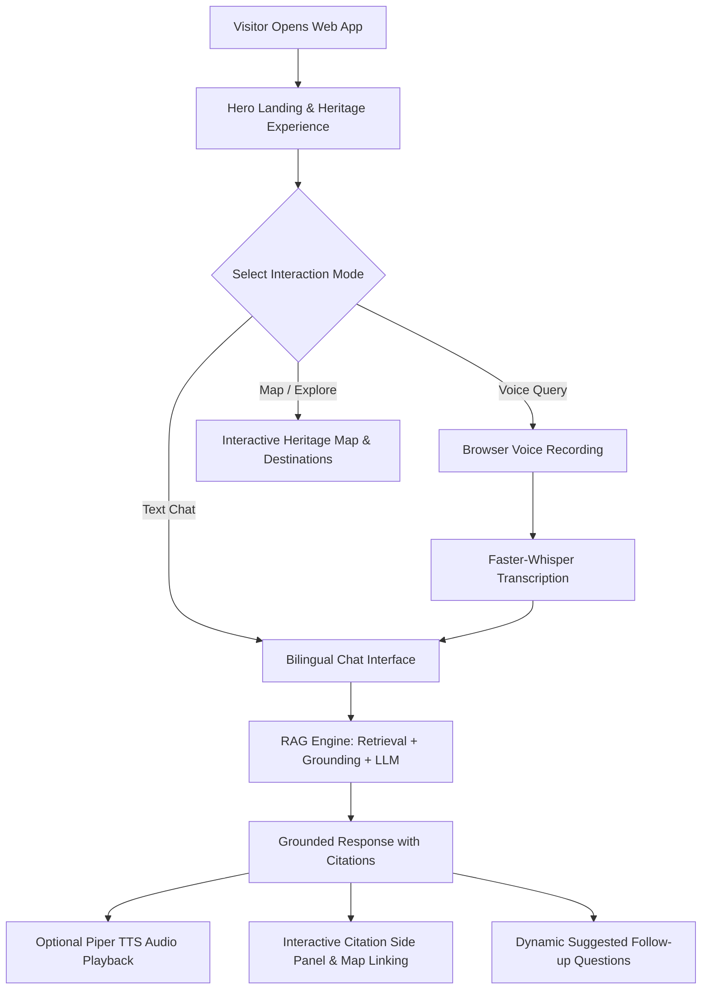
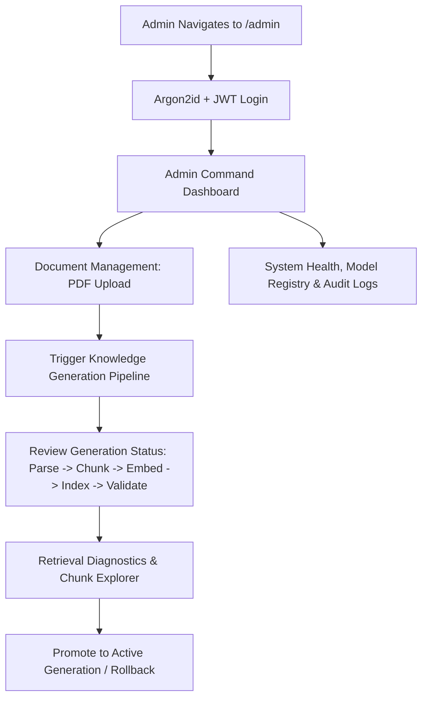

# Product Requirements Document (PRD)

## Project Title
**AI-Powered Smart Tourist Guide Platform for Karnataka**

---

## 1. Executive Summary & Product Vision

The **AI-Powered Smart Tourist Guide Platform for Karnataka** is a commercial-grade, multi-lingual, voice-enabled, local and cloud-deployable digital tourism platform. Designed to celebrate and preserve the rich architectural, historical, cultural, and spiritual heritage of Karnataka, the platform bridges the gap between complex historical records and modern visitors. 

By leveraging advanced Retrieval-Augmented Generation (RAG), local Large Language Models (Ollama), speech recognition (faster-whisper), text-to-speech synthesis (Piper), and offline translation (Argos Translate), the platform delivers verified, citation-backed, conversational tourism guidance without requiring tourists to create accounts or navigate complex portals.

---

## 2. Problem Statement

1. **Information Fragmentation & Inaccuracy**: Tourists visiting Karnataka's historic sites (e.g., Belur Chennakeshava Temple, Halebidu, Hampi, Pattadakal, Badami) face fragmented, unverified, or outdated guide information.
2. **Language Barrier & Local Language Underrepresentation**: While millions of domestic visitors speak Kannada as their mother tongue, digital tourist tools frequently prioritize English or provide poor automated translations that disrespect cultural nuances and accurate historical terminology.
3. **Factual Hallucinations in Commercial AI**: Public generative AI models routinely hallucinate historical dates, royal lineages, architectural elements, and temple folklore. A tourism guide must deliver strictly grounded, evidence-backed information.
4. **Friction-Heavy Tourist Portals**: Traditional tourist applications force users to download heavy mobile apps, sign up, verify emails, or navigate paywalls, severely degrading on-site visitor experiences.
5. **Connectivity & Deployment Constraints**: Remote heritage locations may lack stable high-speed cloud connectivity, requiring a platform capable of running 100% locally/offline in standalone deployment while scaling cleanly to cloud environments.

---

## 3. Target User Personas

### Persona 1: Domestic Karnataka Tourist (Ramesh)
- **Profile**: Native Kannada speaker from Shivamogga visiting Belur with family.
- **Needs**: Fast, spoken/voice or text queries in conversational Kannada. Quick discovery of temple timings, significance of specific sculptures (e.g., Darpana Sundari, Madanikas), and nearby amenities.
- **Pain Point**: Struggles with English-only audio guides or textual signage that lacks depth.

### Persona 2: National Tourist (Ananya)
- **Profile**: English/Hindi-speaking visitor from New Delhi exploring the Hoysala circuit.
- **Needs**: Clear architectural history, lineage of King Vishnuvardhana, contextual explanations of soapstone carvings, and smart suggestions for nearby excursions (Halebidu, Belavadi, Shravanabelagola).
- **Pain Point**: Overwhelmed by unverified internet blogs and aggressive human touts.

### Persona 3: International Heritage Researcher / Traveler (David)
- **Profile**: History enthusiast interested in 12th-century Hoysala art and temple architecture.
- **Needs**: Deep, citation-backed answers with page-level references to scholarly monographs and archaeological reports, interactive map exploration, and structural details.
- **Pain Point**: Needs verifiable academic references, not generic chatbot summaries.

### Persona 4: Karnataka Tourism Department Administrator & Site Curator (Dr. Girish)
- **Profile**: Heritage officer and tourism administrator managing official records.
- **Needs**: Web-based admin dashboard to upload approved research PDFs, inspect extracted chunks and vector embeddings, test retrieval accuracy, manage AI models, promote/rollback knowledge generations, and review visitor inquiry trends and system health.
- **Pain Point**: Inability to update and verify AI knowledge without engineering assistance.

---

## 4. Primary User Journeys & Interaction Modes

### 4.1 Primary Tourist Experience (100% Frictionless — Zero Authentication)

#### Key Tourist Operating Principles:
- **Zero Login**: Tourists NEVER register, log in, or provide phone numbers/emails.
- **Default Language**: **Kannada (ಕನ್ನಡ)**.
- **Automatic Language Detection**: System seamlessly responds in Kannada when queried in Kannada, and English when queried in English.
- **Multi-Turn Context**: Remembers conversation history within the browser session (e.g., "Who built the temple?" followed by "Why?" correctly resolves coreference).
- **Multi-Modal Output**: Instant text streaming + synchronized voice synthesis + verifiable citation cards.

### 4.2 Administrator Journey (Secured Authentication & Knowledge Management)

---

## 5. Functional Requirements

### 5.1 Public Tourist Features (FR-100 Series)
- **FR-101 (Frictionless Access)**: The system shall provide full conversational, voice, map, and destination exploration features without authentication.
- **FR-102 (Bilingual Support)**: The system shall support Kannada and English natively, defaulting to Kannada.
- **FR-103 (Automatic Language Detection)**: The system shall inspect incoming queries and automatically respond in the matching language.
- **FR-104 (Voice Input / STT)**: The system shall capture browser microphone input via standard Web APIs (`MediaRecorder`) and transcribe speech using `faster-whisper` supporting English, Kannada, and code-mixed audio.
- **FR-105 (Voice Output / TTS)**: The system shall synthesize audio for assistant responses using `Piper` (with browser Web Speech API fallback) for both Kannada and English.
- **FR-106 (Streaming Text Responses)**: The system shall deliver LLM responses via Server-Sent Events (SSE) for low initial token latency.
- **FR-107 (Interactive Citations)**: Every factual claim shall link to a citation reference showing the source document name, page number, section, and excerpt snippet.
- **FR-108 (Multi-Turn Conversation)**: The system shall maintain session-level context, resolving follow-up queries, pronouns, and coreferences.
- **FR-109 (Smart Suggestions)**: The system shall generate 3–4 dynamic, contextual follow-up questions after each response.
- **FR-110 (Destination Explorer & Interactive Map)**: The system shall provide rich visual profiles of Karnataka destinations (Belur, Halebidu, Hampi, etc.) with Leaflet/OpenStreetMap markers, historical summaries, timings, entry fees, and nearby attractions.
- **FR-111 (Nearby Attraction Discovery)**: The system shall compute and display nearby attractions with radial distances, travel recommendations, and historical connections.
- **FR-112 (Session Persistence)**: Tourist conversation history shall be persisted locally in browser storage (`localStorage`/`IndexedDB`) for the duration of the visit, with an explicit "Clear Conversation" button.

### 5.2 Strict Grounding & AI Safety (FR-200 Series)
- **FR-201 (Strict Evidence Grounding)**: The LLM prompt engineering and grounding guard shall strictly prevent the model from answering with unverified general training data for factual queries.
- **FR-202 (Missing Evidence Fallback)**: If retrieved context confidence falls below the similarity threshold or contains no relevant evidence, the system shall reply:
  - English: *"Information is not available in the knowledge base."*
  - Kannada: *"ಈ ಮಾಹಿತಿಯು ಜ್ಞಾನ ಭಂಡಾರದಲ್ಲಿ ಲಭ್ಯವಿಲ್ಲ."*
- **FR-203 (Citation Verification)**: The RAG engine shall map every generated citation token against valid chunk IDs in the active knowledge generation.

### 5.3 Administrative & Knowledge Management (FR-300 Series)
- **FR-301 (Admin Authentication)**: The system shall authenticate administrators using Argon2id password hashing and rotating JWT access/refresh tokens.
- **FR-302 (Role-Based Access Control - RBAC)**: The system shall enforce 4 distinct roles: `SUPER_ADMIN`, `SITE_CURATOR`, `OPERATOR`, `VIEWER`.
- **FR-303 (Document Ingestion)**: Administrators shall upload PDF documents with validation (MIME, magic bytes, SHA-256 deduplication, max 50MB).
- **FR-304 (Immutable Knowledge Generations)**: Knowledge processing shall produce immutable generation records (`BUILD` -> `PARSE` -> `CHUNK` -> `EMBED` -> `INDEX` -> `VALIDATE` -> `PROMOTE` -> `ACTIVE`). Active generations shall never be overwritten in-place.
- **FR-305 (One-Click Rollback)**: Administrators shall be able to instantly rollback the active knowledge base to any previous validated generation without re-indexing.
- **FR-306 (Chunk & Embedding Explorer)**: Administrators shall inspect parsed chunks, token lengths, structural headers, page numbers, and 384-dimensional vector representations.
- **FR-307 (Retrieval Diagnostics Tool)**: Administrators shall execute test queries against any generation to inspect dense vs. sparse (BM25) scores, Reciprocal Rank Fusion (RRF) outputs, and Cross-Encoder re-ranking weights.
- **FR-308 (Model & Service Registry)**: Administrators shall view and configure Ollama model parameters (temperature, top_p, model selection: `llama3.1:8b`, `mistral:7b`, `qwen2.5`, `gemma2`), Whisper model sizes, and Piper voices.
- **FR-309 (System Health & Audit Logs)**: The system shall log all administrative actions and display real-time telemetry (CPU, RAM, Disk, MySQL, ChromaDB, Ollama, Whisper, Piper latency).

---

## 6. Non-Functional Requirements

### 6.1 Performance & Latency Targets (NFR-100 Series)
- **NFR-101 (First Token Latency)**: Streamed text response first token shall arrive within $\le 1.8$ seconds on standard local GPU/CPU hardware.
- **NFR-102 (RAG Retrieval Latency)**: Hybrid search (Dense + BM25) + Cross-Encoder re-ranking shall execute in $\le 350$ ms across 50,000 chunks.
- **NFR-103 (STT Transcription Latency)**: Audio transcription for a 5-second voice snippet via `faster-whisper` shall complete in $\le 800$ ms.
- **NFR-104 (TTS Synthesis Latency)**: Speech synthesis generation for a standard response sentence via `Piper` shall begin streaming audio in $\le 600$ ms.
- **NFR-105 (Frontend Load Time)**: Initial Web App bundle load time shall be $\le 1.5$ seconds on broadband, with Lighthouse Performance Score $\ge 90$.

### 6.2 Security & Data Privacy (NFR-200 Series)
- **NFR-201 (Zero Tourist Data Retention)**: No personally identifiable information (PII) or IP addresses shall be permanently tied to tourist chat messages.
- **NFR-202 (Secure Credential Storage)**: Admin passwords hashed with Argon2id ($m=65536, t=3, p=4$). Zero plain-text credentials in logs or code.
- **NFR-203 (API Security)**: All admin routes protected by JWT with short-lived access tokens (15 mins) and rotating refresh tokens (7 days).
- **NFR-204 (Input Sanitization & File Security)**: Uploaded PDFs sanitized against path traversal, checked for valid PDF headers (`%PDF-`), and stored with UUID filenames.
- **NFR-205 (OWASP Alignment)**: Strict CORS policies, Content Security Policy (CSP), rate limiting on all public endpoints (60 req/min per IP), and secure HTTP headers.

### 6.3 Reliability, Offline Capability & Portability (NFR-300 Series)
- **NFR-301 (100% Offline Capability)**: In `APP_PROFILE=standalone` mode, the entire platform (FastAPI, MySQL, ChromaDB, Ollama, Whisper, Argos, Piper, React Web App) shall function without internet connectivity.
- **NFR-302 (Graceful Degradation)**: Failure of an individual AI subsystem (e.g., TTS or STT) shall not crash the core text chat or destination exploration.
- **NFR-303 (Multi-Environment Consistency)**: Zero source-code modifications between `dev`, `standalone`, and `cloud` deployment profiles.

### 6.4 Accessibility & Internationalization (NFR-400 Series)
- **NFR-401 (WCAG 2.1 AA Compliance)**: Minimum contrast ratio of 4.5:1 for standard text, full keyboard navigation, screen-reader semantic landmarks, and ARIA labels.
- **NFR-402 (Kannada Script Rendering)**: Flawless Unicode rendering for Kannada font glyphs (`Noto Sans Kannada`) with proper line heights and zero clipping.

---

## 7. Out-of-Scope & Constraints (Permanent Lock)

1. **No Robotics / Hardware**: The platform is 100% pure software. No ROS2, Jetson, Raspberry Pi, Arduino, sensors, motor controllers, or robot chassis.
2. **No Tourist Accounts**: No tourist sign-up, login, social OAuth, or profile creation.
3. **No Database Swapping**: MySQL 8.0 is strictly locked for transactional persistence. No PostgreSQL or SQLite in production.
4. **No Direct Vector Overwrites**: Knowledge bases must only be updated through versioned, immutable generations.
5. **No External Cloud AI Lock-in**: All core AI pipelines (Ollama, MiniLM, Whisper, Argos, Piper) run self-hosted/locally.
